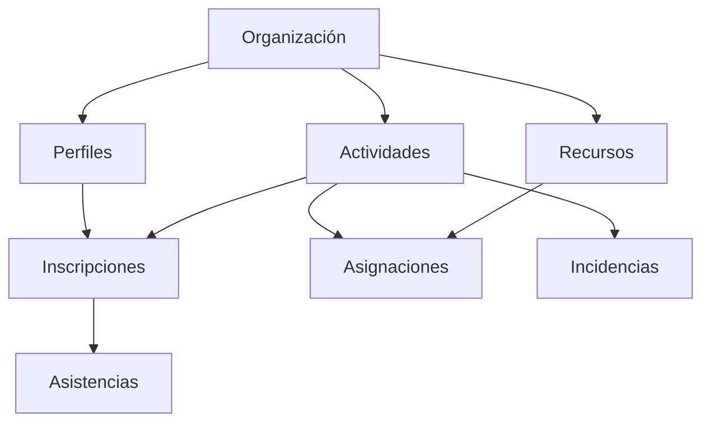

# Modelo y reglas del sistema

El dominio impuesto es la plataforma de voluntariados y actividades comunitarias.
El enunciado permite identificar entidades y reglas; no proporciona un diagrama
ni una lista cerrada de clases. Las siguientes decisiones concretan ese diseño.

## Entidades

| Modelo | Función y relaciones |
|---|---|
| Organizacion | Organización social, información pública y estado activo |
| Perfil | Cuenta Django, rol de voluntario/coordinador, organización y datos privados |
| Categoria | Clasificación de actividades |
| Ubicacion | Dirección y comuna, perteneciente a una organización |
| Actividad | Organización, coordinador, categoría, ubicación, fechas, cupos, visibilidad y estado |
| Inscripcion | Vincula un voluntario con una actividad; única por pareja |
| Asistencia | Una por inscripción; registra horas y observaciones |
| Recurso | Inventario reutilizable de una organización |
| AsignacionRecurso | Reserva de cantidad de un recurso para el horario de una actividad |
| Incidencia | Situación excepcional, reportante, estado y resolución |
| EventoAuditoria | Fecha, autor, entidad, ID, operación, estados y snapshots anterior/posterior |

La cuenta de autenticación es el modelo `User` de Django. `Perfil` amplía esa
cuenta sin duplicar contraseñas. El superusuario representa al administrador.

Categoría y ubicación se vinculan a actividad. Cada escritura por API genera un
evento de auditoría; este conserva IDs y snapshots aunque una entidad se elimine.

## Reglas implementadas

1. Un coordinador necesita organización. Solo gestiona actividades, ubicaciones,
   recursos y participantes de esa organización. No puede asignarse a otra ni
   convertir su cuenta en administrador por la API.
2. Una actividad requiere un coordinador activo y una ubicación de la misma
   organización. Las fechas deben ser coherentes y los cupos positivos.
3. Las actividades nuevas empiezan en borrador o publicadas y en fecha futura.
   Transiciones: borrador → publicada/cancelada; publicada → en_curso/cancelada;
   en_curso → finalizada/cancelada. No se reabren estados terminales. Comenzar y
   finalizar exige que se hayan alcanzado las respectivas fechas.
4. Se inscriben voluntarios activos en actividades publicadas, antes del inicio.
   Las internas requieren pertenencia a la organización. Un voluntario solo se
   inscribe a sí mismo; los coordinadores pueden gestionar participantes.
5. No hay inscripciones duplicadas ni confirmaciones por encima del cupo. Una
   inscripción cancelada se puede reactivar si vuelve a cumplir las condiciones.
6. No se reducen cupos por debajo de confirmados. No se cambian horarios de
   actividades con inscripciones o asignaciones: se cancela y se crea otra para
   preservar el significado de las reservas y participaciones históricas.
7. Solo el coordinador correspondiente o administrador registra asistencia. Se
   requiere inscripción confirmada y actividad en curso/finalizada. Las horas
   son no negativas y no superan el tiempo transcurrido de la actividad.
8. Los recursos son de la misma organización que la actividad. La suma máxima
   de reservas simultáneas no supera el inventario. Intervalos consecutivos
   pueden reutilizar el recurso; el cálculo usa intervalos [inicio, fin).
9. Cancelar una actividad cancela sus inscripciones confirmadas y libera sus
   recursos, registrando cada cambio. Finalizar libera recursos. Las asistencias
   ya registradas se conservan como hechos históricos, incluso ante cancelación.
10. Un participante puede reportar una incidencia. El coordinador puede pasarla
    a revisión y resolverla, con explicación obligatoria. El reportante no puede
    resolverla ni editarla una vez en revisión. No se reabren incidencias resueltas.
11. Los datos privados de perfiles son visibles solo al titular o administrador.
    Inscripciones y asistencias son visibles al titular y a su coordinador.
    Incidencias son visibles al reportante y a su coordinador. La auditoría no
    es pública; coordinadores no ven snapshots de perfiles.
12. DELETE funciona para registros que admiten eliminación. Dependencias se
    protegen con `PROTECT`; se devuelve 409 y se revierte también la auditoría
    provisional. Actividades/inscripciones históricas e incidencias revisadas
    se conservan. La auditoría acepta únicamente GET.

## Integridad y transacciones

La base aplica claves foráneas, unicidad de inscripciones/asignaciones/asistencias
y restricciones de fechas, cupos y cantidades. Los serializers añaden reglas
que involucran varias entidades y al usuario autenticado.

Cada escritura de un ModelViewSet ocurre en una transacción junto con su auditoría.
En MySQL se bloquean las organizaciones en un orden estable antes de validar.
Esto protege cupos y reservas concurrentes. Para este volumen académico se
serializan las escrituras entre organizaciones; a mayor escala conviene limitar
los bloqueos a las organizaciones afectadas. SQLite sirve como alternativa de
prueba funcional, no como evidencia de estos bloqueos concurrentes.

Los catálogos del dominio se inspeccionan en el admin Django, pero se editan por
API. Cambios hechos directamente por SQL u ORM fuera de este flujo no están
cubiertos por la auditoría de aplicación. La carga demo usa serializers y genera
eventos. Administradores de infraestructura siguen teniendo acceso a la base.

## Indicadores

- Actividades y distribución por estado: sobre las actividades visibles del ámbito solicitado.
- Inscripciones recientes: creadas en los últimos 30 días, incluidas las canceladas.
- Tendencia mensual: cantidad creada por mes UTC, sin confundirla con asistencia efectiva.
  UTC permite calcularla en MySQL sin requerir tablas adicionales de zonas horarias.
- Voluntarios distintos: personas con al menos una inscripción en el ámbito.
- Horas y asistencias: registros efectivamente cargados por coordinadores.
- Ocupación: confirmados / suma de cupos de actividades no borrador ni canceladas.
- Utilización actual: unidades reservadas en actividades cuyo horario contiene el momento
  actual / inventario de organizaciones presentes en la selección de actividades.
- Incidencias pendientes: abiertas o en revisión.

Las métricas usan consultas separadas para evitar duplicar sumas al combinar
varias relaciones uno-a-muchos. No hay tareas automáticas que cambien estados
por reloj: el coordinador registra cada transición explícitamente.
